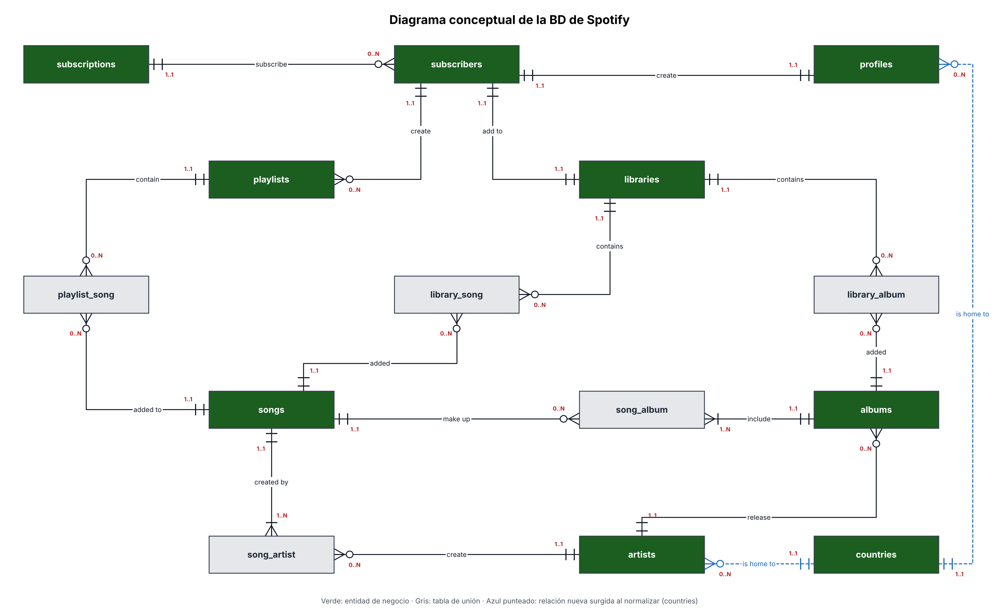
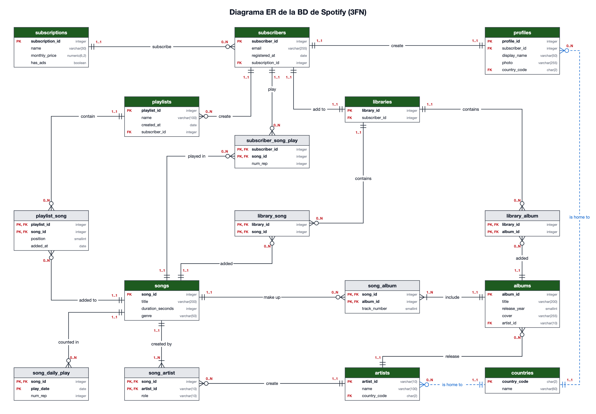

# BD de Spotify: implementación en PostgreSQL

Proyecto del curso de Ingeniería de Datos. Implementa en **PostgreSQL 18**, dentro de **Docker**, la base de datos transaccional de Spotify a partir del modelo conceptual y el diagrama ER diseñados previamente, la carga con los datos de Laura y comprueba que sus reglas de negocio se cumplen.

## Contexto

Laura administraba la información de Spotify en un sistema anterior y nos entregó cuatro exports:

| Export | Contenido |
|---|---|
| Tabla A | Playlists: dueño, suscripción, precio, anuncios y las canciones en orden, con la fecha en que se agregaron |
| Tabla B | Créditos de canciones: duración, género y los artistas con su país y su rol (principal o feat.) |
| Tabla C | Álbumes: año, portada, artista y sus pistas |
| Tabla D | Suscriptores: registro, suscripción, perfil (nombre visible, foto, país) y lo que guardan en su biblioteca |

En una etapa previa de diseño esos datos se normalizaron hasta 3FN y se integraron con el diagrama conceptual unificado. El resultado son **14 tablas**: 9 entidades (`subscriptions`, `subscribers`, `profiles`, `libraries`, `playlists`, `songs`, `artists`, `albums` y `countries`, que surgió al normalizar) y 5 tablas de unión (`playlist_song`, `song_artist`, `song_album`, `library_song` y `library_album`).

La base cubre suscripciones y suscriptores, el perfil y la biblioteca de cada suscriptor, las playlists con sus canciones en orden y el catálogo de canciones, artistas y álbumes. **No** guarda reproducciones, por eso la pregunta «¿cuál es la canción más escuchada?» no se puede responder (ver `tests.sql`).

`db/02_seed.sql` carga **todos** los datos de Laura con sus identificadores originales (`song_id`, `album_id`, `artist_id`, `playlist_id`) y agrega lo necesario para que existan estos cuatro casos:

| Caso | Cómo se cubre |
|---|---|
| Una suscripción sin suscriptores | Plan nuevo `Estudiantes` (subscription_id 4) |
| Un artista sin canciones ni álbumes | Artista nuevo `A11` (Natanael Cano) |
| Una playlist vacía | Playlist 13 (Viaje), ya venía en los datos de Laura |
| Una canción sin álbum | Canción 108 (Calor de Agosto), ya venía en los datos de Laura |

Transformaciones aplicadas: duración «m:ss» → segundos, anuncios «sí»/«no» → `true`/`false`, foto vacía → `NULL`, y el rol se conserva tal cual (`'principal'` o `'feat.'`).

## Supuestos

1. Una canción no se repite dentro de una playlist, y cada posición tiene una sola canción.
2. El título y la duración son datos de la canción; no cambian según la playlist o el álbum.
3. Un suscriptor tiene una sola suscripción a la vez, y todos los suscriptores de un plan pagan lo mismo.
4. Un artista aparece una sola vez en los créditos de una canción; su rol es principal o feat.
5. Cada canción tiene un solo género.
6. El código de país (ISO de dos letras) determina su nombre.
7. Una canción aparece una sola vez en un álbum, y cada álbum es de un solo disco: el número de pista no se repite.
8. Cada álbum lo publica un solo artista.
9. Guardar un álbum no equivale a guardar cada una de sus canciones.
10. La foto del perfil es opcional.
11. Se usan llaves sustitutas (`subscription_id`, `subscriber_id`, `profile_id`, `library_id`) porque el nombre del plan y el email pueden cambiar.
12. `profiles` y `libraries` no surgieron al normalizar (relación 1:1 con `subscribers`); se conservan por el diagrama conceptual unificado.
13. Los datos agregados (plan Estudiantes y artista A11) son de prueba, para cubrir casos límite que la base debe soportar.

Los supuestos también están en los comentarios de `db/01_schema.sql` y `db/02_seed.sql`, junto a la tabla o el dato al que afectan.

## Requisitos

- Docker con Docker Compose (Docker Desktop en macOS/Windows o Docker Engine en Linux).
- El puerto `5432` libre.

## Variables de entorno (`.env`)

Las credenciales no se suben al repositorio. Crea tu `.env` a partir de la plantilla:

```bash
cp .env.example .env
```

| Variable | Valor |
|---|---|
| `POSTGRES_USER` | `admin` |
| `POSTGRES_PASSWORD` | la contraseña que quieras (es una base local de práctica) |
| `POSTGRES_DB` | `spotify` |

Estos valores solo se usan cuando PostgreSQL se inicializa con el volumen vacío. Si los cambias después, borra el volumen con `docker compose down -v`.

## Cómo ejecutar

Todos los comandos se ejecutan en la carpeta del repositorio, donde está `docker-compose.yml`.

```bash
# 1. Iniciar PostgreSQL. Con el volumen vacío crea la base y ejecuta, en orden,
#    db/01_schema.sql (tablas) y db/02_seed.sql (datos).
docker compose up -d

# 2. Revisar que la inicialización no tuvo errores. Si no muestra nada, todo bien.
#    (Espera unos segundos tras el paso 1; la primera vez también descarga la imagen.)
docker compose logs postgres | grep ERROR

# 3. Ejecutar las pruebas.
docker compose exec postgres psql -U admin -d spotify -f /tests.sql

# 4. (Opcional) Abrir una consola de SQL. Se sale con \q
docker compose exec postgres psql -U admin -d spotify

# 5. Detener y borrar todo, incluido el volumen con los datos.
docker compose down -v
```

Después de ejecutar `tests.sql`, `docker compose logs postgres | grep ERROR` muestra los errores **intencionales** de las pruebas (los intentos de romper las reglas y los dos fallos a propósito dentro de las transacciones). Eso es lo esperado.

## Qué hace `tests.sql`

Cada sección se titula con `\echo` en la salida.

**a) Las preguntas de Laura**

| # | Pregunta | Resultado |
|---|---|---|
| 1 | ¿Qué canciones tiene la playlist 10, en orden, y quiénes son sus artistas? | 1 Ella Baila Sola (Eslabon Armado, Peso Pluma) · 2 TQG (Karol G, Shakira) · 3 Bzrp Music Sessions #53 (Bizarrap, Shakira) |
| 2 | ¿Cuántos suscriptores tiene cada suscripción, incluidas las que no tienen? | Premium 1 · Gratuita 1 · Familiar 2 · Estudiantes 0 (`LEFT JOIN` + `COUNT(columna)`) |
| 3 | ¿Qué canciones no están en ningún álbum? | 108 Calor de Agosto |
| 4 | ¿Qué tiene guardado cada suscriptor en su biblioteca? | Canciones y álbumes en una sola consulta (`UNION ALL` con columna `tipo`); marta aparece con una fila vacía |
| 5 | ¿Cuál es la canción más escuchada? | **No se puede responder:** no hay reproducciones. Se propone la tabla `plays(play_id, subscriber_id, song_id, played_at)` y una consulta de ejemplo, ambas comentadas |

**b) Intentos de romper las reglas.** 19 instrucciones que PostgreSQL debe rechazar con `ERROR`, al menos una por cada tipo de restricción del esquema y cada una con un comentario sobre la regla de negocio que protege: `PRIMARY KEY` simple y compuesta, `FOREIGN KEY` al insertar, borrar y actualizar, `NOT NULL`, `UNIQUE` simple y compuesto, y `CHECK`. Al final, un conteo confirma que ningún intento dejó cambios.

**c) Registro y eliminación de un suscriptor.** Transacciones todo o nada (`BEGIN ... COMMIT`/`ROLLBACK`):

1. **Registro fallido:** se insertan la suscriptora 5 (Sofía) y su perfil, pero la biblioteca reutiliza `library_id = 1` → error → `ROLLBACK`. Una consulta muestra que no quedó nada.
2. **Registro exitoso:** suscriptor, perfil y biblioteca 5 → `COMMIT`.
3. **Preparación:** Sofía crea la playlist 15 con dos canciones y guarda una canción y un álbum.
4. **Eliminación fallida:** con ana se borran sus dependencias, pero se intenta borrar `subscribers` antes que `libraries` y `profiles` → error de llave foránea → `ROLLBACK`. Los conteos antes y después son idénticos.
5. **Eliminación exitosa:** los siete `DELETE` de Sofía en orden de dependencias (`library_song`, `library_album`, `playlist_song`, `playlists`, `libraries`, `profiles`, `subscribers`) → `COMMIT`. El catálogo sigue con 8 canciones, 6 álbumes y 11 artistas.

Al terminar, la base queda exactamente como la dejó `02_seed.sql`, así que `tests.sql` se puede ejecutar varias veces con la misma salida.

## Estructura del repositorio

```
.
├── db/
│   ├── 01_schema.sql          # CREATE TABLE de las 14 tablas, en orden de dependencias
│   └── 02_seed.sql            # INSERT de los datos de Laura y los casos agregados
├── docs/
│   ├── diagrama_conceptual.png
│   └── diagrama_er.png
├── .env.example               # Plantilla de credenciales (el .env real no se sube)
├── .gitignore
├── docker-compose.yml         # Servicio postgres:18 con db/ y tests.sql montados
├── tests.sql                  # Preguntas de Laura, intentos de romper reglas y transacciones
└── README.md
```

### Diagrama conceptual

Diagrama unificado con las entidades y relaciones, incluida `countries`, que surgió al normalizar (línea azul punteada).



### Diagrama ER

Atributos, tipos de dato, PK y FK. Coincide con `db/01_schema.sql`.



## Cardinalidades y restricciones

Cada cardinalidad del diagrama se traduce en restricciones:

| Cardinalidad | Restricción |
|---|---|
| Mínimo 1 del lado «uno» (toda fila hija tiene padre) | FK `NOT NULL` (p. ej. `playlists.subscriber_id`, `subscribers.subscription_id`, `albums.artist_id`) |
| Máximo 1 del lado dependiente de una 1:1 | `UNIQUE` en la FK (`profiles.subscriber_id`, `libraries.subscriber_id`) |
| Relaciones N:M | Tabla de unión con PK compuesta (el par no se repite) y una FK a cada lado |

Otras reglas de negocio implementadas: `UNIQUE (playlist_id, position)` y `UNIQUE (album_id, track_number)`; emails, nombres de plan y nombres de país únicos; y `CHECK` para el precio ≥ 0, el formato del email, el código de país de dos letras mayúsculas, la duración > 0, el año entre 1900 y 2100, la posición y la pista > 0, y el rol en `('principal', 'feat.')`.

Ninguna llave foránea usa `ON DELETE CASCADE`: borrar un suscriptor exige borrar sus dependencias de forma explícita y en orden, y no se puede borrar del catálogo algo que está en uso.

### Cardinalidades que no se pueden garantizar con restricciones

- **Todo álbum tiene al menos una canción y toda canción al menos un artista** (mínimo 1 del lado «muchos» de `song_album` y `song_artist`). Forzarlo requeriría triggers, que están fuera del alcance. Se cumple en los datos cargados.
- **Todo suscriptor tiene perfil y biblioteca** (mínimo 1 del lado del suscriptor en las relaciones 1:1). Una FK solo puede ir en una dirección, así que se garantiza con la **transacción de registro** de `tests.sql`, que crea los tres o ninguno.

## Cambios respecto al diagrama ER

Ninguno. El esquema implementa exactamente el diagrama ER diseñado previamente (`docs/diagrama_er.png`): mismas tablas, columnas, tipos y relaciones.
